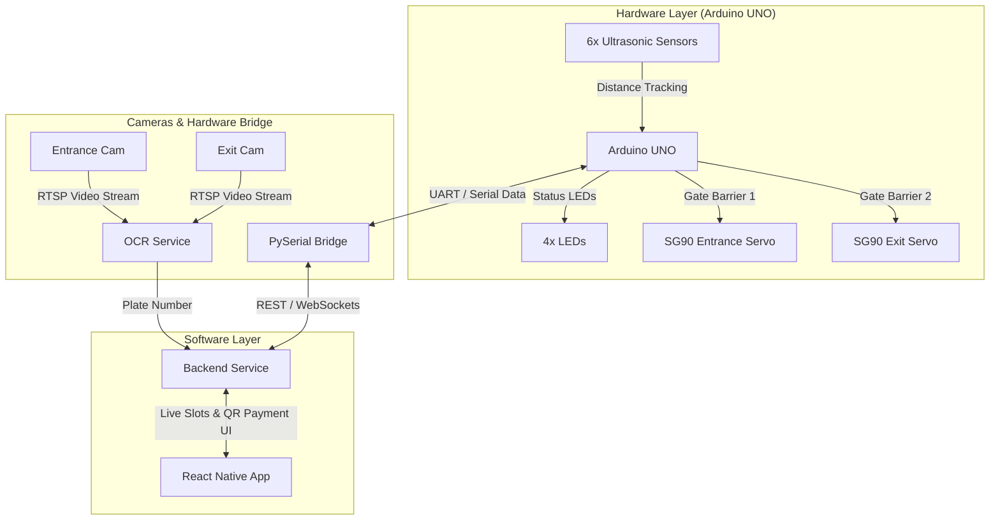

# Smart Parking System

An end-to-end automated parking management prototype integrating microcontrollers, computer vision (OCR), a PySerial hardware bridge, and mobile interfaces.

---

## System Architecture

---

## Key Features

* **Automated Entry & Exit:** Camera-based OCR plate recognition triggers entrance and exit servo barriers.
* **Real-time Slot Occupancy:** 6 ultrasonic sensors continuously track parking space availability and update visual LED indicators.
* **Hardware-to-Cloud Bridge:** A lightweight Python `pyserial` gateway translating Arduino UART signals into REST/WebSocket backend events.
* **Dual-Display Mobile Interface:** React Native screens serving as real-time available slot counters at entry and dynamic mock QR code payment points at exit.

---

## Hardware Components

| Component | Qty | Description |
| :--- | :---: | :--- |
| **Arduino UNO R3** | 1 | Primary hardware controller unit |
| **HC-SR04 Ultrasonic Sensors** | 6 | Parking space occupancy detection |
| **SG90 Micro Servos** | 2 | Entrance and exit barrier gate control |
| **Status LEDs** | 4 | Local visual indicators for slot availability |
| **Solderless Breadboard** | 1 | Power distribution and signal routing |
| **Smartphones** | 2 | IP camera streaming sources & React Native displays |

> *TinkerCAD 3D models, schematics, and iterative build steps are stored in [`hardware/steps/`](./hardware/steps/).*

---

## License

Distributed under the [MIT License](LICENSE).