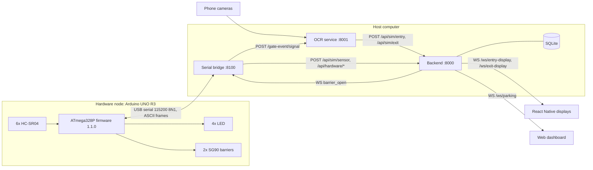

# Parkly Smart Parking System


[](docs/architecture.md)
[](docs/api_spec.md)

Parkly is an automated parking-lot prototype. An Arduino UNO R3 measures slot occupancy with ultrasonic sensors and drives two servo barriers. A Python serial bridge translates a checksummed ASCII serial protocol into REST and WebSocket traffic. An OCR service reads licence plates from phone cameras. A FastAPI backend owns parking sessions, billing (mock payment) and display channels. A React Native application renders the entry and exit displays, and a web dashboard visualizes the lot.

Detailed documentation:

| Document | Content |
| :--- | :--- |
| [`docs/architecture.md`](docs/architecture.md) | Hardware design, pin mapping, firmware state machines, gateway behaviour, documented discrepancies |
| [`docs/api_spec.md`](docs/api_spec.md) | Serial protocol, bridge API, backend REST and WebSocket API, OCR API |
| [`hardware/README.md`](hardware/README.md) | Incremental hardware build history (steps 01 to 08) |
| [`services/serial_bridge/docs/PROTOCOL.md`](services/serial_bridge/docs/PROTOCOL.md) | Original serial protocol description |
| [`services/serial_bridge/docs/TEST_PLAN.md`](services/serial_bridge/docs/TEST_PLAN.md) | Automated, mock-mode and bench test plan |

---

## Table of Contents

1. [Project Overview](#1-project-overview)
2. [Bill of Materials](#2-bill-of-materials)
3. [System Architecture Summary](#3-system-architecture-summary)
4. [Repository Structure](#4-repository-structure)
5. [Hardware Setup and Firmware Flashing](#5-hardware-setup-and-firmware-flashing)
6. [Software Installation](#6-software-installation)
7. [Verification and End-to-End Testing](#7-verification-and-end-to-end-testing)
8. [Known Discrepancies](#8-known-discrepancies)
9. [Contributing and License](#9-contributing-and-license)

---

## 1. Project Overview

| Capability | Implementation |
| :--- | :--- |
| Slot occupancy detection | 4 HC-SR04 sensors (slots P1 to P4); median filtering, hysteresis and asymmetric debounce in firmware; one red LED per slot |
| Gate vehicle detection | 2 HC-SR04 sensors (entry and exit gates) |
| Barriers | 2 SG90 servos, opened by command only; closing is refused while a vehicle is under the sensor |
| Plate recognition | OpenCV candidate localization and EasyOCR recognizer; cameras are phones exposed as local video devices or network streams |
| Parking logic | FastAPI backend, SQLite database, session state machine, per-minute tariff, mock payment with QR page |
| Hardware gateway | Python bridge, sole owner of the serial port; retransmission, de-duplication and reconnect handling |
| User interfaces | React Native (Expo) entry and exit displays; browser display pages served by the backend; React web dashboard |

Access principle: a plate recognition event never opens a barrier by itself. A barrier opens only after the backend authorizes the session (entry admission, successful payment, staff pass, or operator override).

---

## 2. Bill of Materials

| Component | Qty | Specification and role |
| :--- | :---: | :--- |
| Arduino UNO R3 (clone with DC jack) | 1 | ATmega328P, 5 V logic, 16 MHz; controller; USB serial link to the host |
| HC-SR04 ultrasonic sensor | 6 | 4 for slot occupancy, 2 for gate vehicle detection; 5 V supply |
| SG90 micro servo | 2 | Entry and exit barriers; powered from the Arduino 5 V pin |
| Red LED | 4 | Per-slot occupancy indicator |
| Resistor 1 kΩ | 4 | Series resistors RR1 to RR4 for the LEDs |
| Solderless breadboard | 1 | Power distribution and signal routing |
| Jumper wires, USB A-B cable | as needed | Wiring; USB provides 5 V power and the serial link |
| Smartphones | 2 | Cameras (exposed to the host as a local video device index or an `rtsp://` / `http://` stream URL) and display terminals running the React Native application |
| Host computer | 1 | Runs backend, OCR service and serial bridge; Python 3.10 or later |

The prototype has no external servo supply. Servos and sensors share the Arduino 5 V rail with a common ground. See `docs/architecture.md` section 3.5 and section 8 for the power-related discrepancy.

---

## 3. System Architecture Summary



Data flow for one visit:

1. The entry gate sensor reports `GATE,entry,1`; the bridge asks the OCR service to capture and read the plate.
2. The OCR service forwards a trusted plate to the backend, which creates a session and publishes `barrier_open` for the entry gate.
3. The bridge sends `OPEN,entry`; the Arduino raises the barrier, reports `BARRIER,entry,OPENED`, and closes after the vehicle has cleared.
4. A slot sensor reports `SLOT,<n>,1`; the bridge posts it to the backend, which binds the vehicle to the slot.
5. At the exit gate the plate is read again; the backend issues a bill and QR code on the exit display. After payment the backend publishes `barrier_open` for the exit gate.

---

## 4. Repository Structure

```
parkly/
|-- README.md
|-- LICENSE
|-- .github/
|   |-- CODEOWNERS
|   |-- COMMIT_CONVENTION.md
|   |-- ISSUE_TEMPLATE/
|   `-- PULL_REQUEST_TEMPLATE.md
|-- docs/
|   |-- architecture.md
|   `-- api_spec.md
|-- hardware/
|   |-- README.md
|   `-- steps/
|       |-- step_01_single_led/ ... step_07_servos_sensors/   (prototype sketches, notes, build videos)
|       `-- step_08_full_assembly/
|           |-- PROTOTYPE-v08.md
|           |-- prototype_v08.ino
|           |-- circuits-v08.png
|           `-- schematics-v08.pdf
`-- services/
    |-- backend/              FastAPI backend (app/, tests/, requirements.txt)
    |-- ocr_service/          OpenCV + EasyOCR plate recognition (app/, scripts/, tests/, .env)
    |-- serial_bridge/
    |   |-- arduino/smart_parking/smart_parking.ino   production firmware 1.1.0
    |   |-- app/              bridge implementation
    |   |-- docs/             PROTOCOL, AUDIT, INTEGRATION_PLAN, TEST_PLAN
    |   |-- tests/            unit, firmware host and integration tests
    |   `-- tools/hostsim/    PC shim used to compile the firmware for host tests
    |-- mobile/               Expo / React Native entry and exit displays
    `-- web_admin/            React + Vite dashboard (consumes /ws/parking)
```

---

## 5. Hardware Setup and Firmware Flashing

### 5.1 Tools and requirements

| Item | Requirement |
| :--- | :--- |
| IDE | Arduino IDE 1.8.x or 2.x. The repository contains no PlatformIO configuration; PlatformIO users must create a project for board `uno` and use the `.ino` file as the main source |
| Board | Arduino UNO (`arduino:avr:uno`) |
| Libraries | `Servo` (bundled with the Arduino IDE). No other third-party library is used |
| USB driver | Genuine boards need no driver on current operating systems. A clone board with a CH340 USB-serial chip may require the CH340 driver |
| Serial settings | 115200 baud, 8N1 |

### 5.2 Wiring

Firmware 1.1.0 pin assignment (the authoritative source is `smart_parking.ino`):

| Function | TRIG | ECHO | Output |
| :--- | :---: | :---: | :--- |
| Slot 1 (P1) | D13 | D12 | LED D11 |
| Slot 2 (P2) | D10 | D9 | LED D8 |
| Slot 3 (P3) | D6 | D5 | LED D7 |
| Slot 4 (P4) | D3 | D2 | LED D4 |
| Entry gate sensor | A1 | A0 | Servo signal A2 |
| Exit gate sensor | A4 | A3 | Servo signal A5 |

Wiring rules:

- Each LED is connected through a 1 kΩ resistor to GND.
- All sensors and both servos take 5 V and GND from the Arduino and share a common ground.
- Servo signal pins `A2` and `A5` are used as digital outputs.
- The wiring in `hardware/steps/step_08_full_assembly/schematics-v08.pdf` assigns the slot and gate pins differently from firmware 1.1.0 (see Section 8). Wire the board according to the table above when flashing `smart_parking.ino`, or flash `prototype_v08.ino` when following the schematic.

Full pin tables with component pins and signal types: `docs/architecture.md` section 4.

### 5.3 Flashing procedure

1. Open `services/serial_bridge/arduino/smart_parking/smart_parking.ino` in the Arduino IDE.
2. Select `Tools > Board > Arduino UNO` and the serial port of the board.
3. Select `Sketch > Verify/Compile`. Confirm that compilation succeeds.
4. Select `Sketch > Upload`.
5. Open the Serial Monitor at 115200 baud with line ending `Newline` or `No line ending`.
6. Confirm the boot frames described in Section 7.1.
7. Close the Serial Monitor before starting the serial bridge. Only one program can own the port, and opening the port resets an UNO.

Optional bench test without the physical gate wiring: paste the sketch into Tinkercad and follow `services/serial_bridge/docs/TEST_PLAN.md` section C (the expected boot version there is `1.0.0`; this repository's firmware reports `1.1.0`).

---

## 6. Software Installation

### 6.1 Prerequisites

| Item | Requirement |
| :--- | :--- |
| Python | 3.10 or later (backend, OCR service, bridge) |
| Node.js | Current LTS with npm (mobile application, web dashboard) |
| Compiler | `g++` (only for the firmware host tests) |
| Network | Host computer and phones on the same local network |

Run each Python service in its own virtual environment:

```bash
python3 -m venv .venv && source .venv/bin/activate      # Windows: .venv\Scripts\activate
pip install -r requirements.txt
```

### 6.2 Backend (port 8000)

| Package (pinned) | Version |
| :--- | :--- |
| fastapi | 0.115.0 |
| uvicorn[standard] | 0.30.6 |
| sqlalchemy | 2.0.35 |
| jinja2 | 3.1.4 |
| python-multipart | 0.0.9 |
| qrcode[pil] | 7.4.2 |
| websockets | 13.1 |
| pydantic | 2.9.2 |
| pytest / httpx | 8.3.3 / 0.27.2 |

```bash
cd services/backend
pip install -r requirements.txt
uvicorn app.main:app --host 0.0.0.0 --port 8000
```

The backend reads no environment variables for its parameters. Settings are constants in `services/backend/app/core/config.py` and are changed by editing that file:

| Constant | Default | Meaning |
| :--- | :--- | :--- |
| `PORT` | 8000 | Port used in generated URLs |
| `BASE_URL` | `None` (LAN address auto-detected) | Public URL embedded in payment QR codes; set it when auto-detection selects the wrong interface |
| `DATABASE_URL` | `sqlite:///./smart_parking.db` | Database, created in the working directory |
| `CURRENCY` | `KGS` | Currency label |
| `BILLING_START` | `parked` | `parked` or `entry` |
| `AUTH_TTL_SECONDS` | 120 | Validity of a barrier authorization |
| `PENDING_ENTRY_TTL_SECONDS` | 900 | Lifetime of an entered but not yet parked vehicle |
| `AMBIGUOUS_SLOT_POLICY` | `fifo` | `fifo` or `reject` |
| `SLOTS` | `P1` to `P4` | Slot names |

The QR code encodes `BASE_URL`; the phone that scans it must be able to reach that address.

### 6.3 OCR service (port 8001)

| Package (pinned) | Version |
| :--- | :--- |
| fastapi | 0.115.0 |
| uvicorn[standard] | 0.30.6 |
| python-multipart | 0.0.9 |
| opencv-python-headless | 4.10.0.84 |
| easyocr | 1.7.2 |
| numpy | 1.26.4 |
| pydantic-core | 2.23.4 |
| httpx | 0.27.2 |
| pytest | 8.0 or later |

```bash
cd services/ocr_service
pip install -r requirements.txt
uvicorn app.main:app --host 127.0.0.1 --port 8001
```

The first start downloads the EasyOCR model unless it is already cached. At start-up the service opens the cameras and loads and warms up the model before it begins answering requests. The GPU is used automatically when PyTorch detects one.

The service reads four environment variables (`app/config.py`). All other parameters are constants in the module that uses them.

| Variable | Default (code) | Meaning |
| :--- | :--- | :--- |
| `BACKEND_BASE_URL` | `http://localhost:8000` | Backend address; plates are posted to `/api/sim/entry` and `/api/sim/exit` |
| `BACKEND_SERVICE_TOKEN` | empty | Sent as `X-Service-Token` when set (the backend ignores it) |
| `ENTRY_CAMERA_SOURCE` | `1` | Entry camera: video device index or stream URL (`rtsp://...`, `http://...`) |
| `EXIT_CAMERA_SOURCE` | `3` | Exit camera: same format. When both variables are equal, one camera serves both gates |

Variables can be exported in the shell or kept in `services/ocr_service/.env` and loaded with `uvicorn app.main:app --env-file .env`. The `.env` file in the repository sets the entry camera to index `2`; the code default is `1` (see Section 8). Camera device indexes are listed with `python scripts/find_cameras.py` (stop the service first).

Operating constants (not environment variables): burst of up to 10 frames within 4.0 s per gate signal (`BURST_ATTEMPTS`, `BURST_DEADLINE` in `app/api.py`), maximum 2 corrected characters for a plate to be trusted (`MAX_CORRECTIONS_TO_TRUST` in `app/config.py`), backend timeout 5.0 s (`BACKEND_TIMEOUT_SECONDS`). Recognition accepts only plates matching `\d{2}KG\d{3}[A-Z]{3}` with region codes 01 to 11.

### 6.4 Serial bridge (port 8100)

| Package | Version |
| :--- | :--- |
| pyserial | 3.5 |
| fastapi, uvicorn, httpx, websockets, pydantic | unpinned |
| pytest | unpinned |

```bash
cd services/serial_bridge
pip install -r requirements.txt
BRIDGE_SERIAL_PORT=/dev/ttyACM0 uvicorn app.main:app --host 127.0.0.1 --port 8100
```

On Windows use `set BRIDGE_SERIAL_PORT=COM3` before starting uvicorn. Run the bridge with a single worker. `BRIDGE_SERIAL_PORT=mock://` starts a simulated Arduino and the `/sim/*` endpoints.

Environment variables (defaults from `services/serial_bridge/app/config.py`):

| Variable | Default | Meaning |
| :--- | :--- | :--- |
| `BRIDGE_SERIAL_PORT` | `auto` | Port name (`COM3`, `/dev/ttyACM0`), `auto` to detect an Arduino, or `mock://` |
| `BRIDGE_SERIAL_BAUD` | `115200` | Must match the firmware |
| `BRIDGE_SERIAL_BOOT_DELAY` | `2.0` | Seconds to wait after opening the port (UNO resets) |
| `BRIDGE_RECONNECT_MIN` / `BRIDGE_RECONNECT_MAX` | `1.0` / `10.0` | Reconnect backoff in seconds |
| `BRIDGE_LINK_TIMEOUT` | `8.0` | Seconds without any byte before the link is declared dead |
| `BRIDGE_ACK_TIMEOUT` / `BRIDGE_ACK_RETRIES` | `0.6` / `3` | Command acknowledgement |
| `BRIDGE_BACKEND_URL` | `http://localhost:8000` | Backend address |
| `BRIDGE_OCR_URL` | `http://localhost:8001` | OCR service address |
| `BRIDGE_HTTP_TIMEOUT` | `5.0` | Backend call timeout (s) |
| `BRIDGE_OCR_TIMEOUT` | `30.0` | One OCR trigger (s) |
| `BRIDGE_OCR_MAX_ATTEMPTS` / `BRIDGE_OCR_RETRY_DELAY` | `3` / `2.0` | Re-read attempts while the vehicle waits |
| `BRIDGE_SLOT_MAP` | `1:P1,2:P2,3:P3,4:P4` | Device slot index to backend slot name |
| `BRIDGE_SLOT_VACANT_POLICY` | `forward` | `forward`, `skip_staff` or `ignore` |
| `BRIDGE_SLOT_RETRY_ATTEMPTS` | `5` | Attempts per slot update |
| `BRIDGE_SLOT_RECONCILE_INTERVAL` | `10.0` | Seconds between repair attempts |
| `BRIDGE_SLOT_UNMATCHED_MAX` | `30` | Stop re-sending an occupancy the backend keeps rejecting |
| `BRIDGE_SLOT_SETTLE_S` / `BRIDGE_SLOT_MIN_INTERVAL_S` | `0.3` / `1.0` | Settle time and per-slot rate limit |
| `BRIDGE_OPEN_HOLD_MS` | `8000` | Hold time sent with `OPEN` |
| `BRIDGE_OPEN_DEADLINE` | `10.0` | Give-up time for an open request (s) |
| `BRIDGE_OPEN_DEDUPE_SECONDS` | `15.0` | Suppression window for repeated open requests |
| `BRIDGE_API_TOKEN` | empty | If set, `POST /v1/*` requires header `X-Bridge-Token` |
| `BRIDGE_SERVICE_TOKEN` | empty | Sent to the backend as `X-Service-Token` |
| `BRIDGE_BACKEND_WS_ENABLED` | `true` | Subscribe to backend display channels for `barrier_open` |
| `BRIDGE_AUTH_POLL_INTERVAL` | `3.0` | Authorization polling fallback (s) |
| `BRIDGE_DEVICE_CFG` | empty | `CFG` pairs pushed on every connect, for example `slot_thr=20,hyst=6` |
| `BRIDGE_LOG_LEVEL` / `BRIDGE_LOG_FORMAT` | `INFO` / `json` | `json` or `text` |

Further variables (`BRIDGE_RX_BACKLOG_MAX`, `BRIDGE_BAD_FRAME_LOG_INTERVAL`, `BRIDGE_UNEXPECTED_BOOT_WINDOW_S`, `BRIDGE_REPORT_ATTEMPTS`, `BRIDGE_CLEAR_REPORT_WINDOW`, `BRIDGE_MOCK_*`) are defined in `config.py`.

Security note: any client that can reach `POST /v1/barrier/{gate}/open` can lift a barrier. Keep the bridge bound to `127.0.0.1` and set `BRIDGE_API_TOKEN` in any shared environment. The backend itself has no authentication (see `docs/api_spec.md` section 4.3).

### 6.5 Mobile displays

```bash
cd services/mobile
npm install
npm start
```

Stack: Expo, React Native, TypeScript. The application asks for the backend address (`host:port`, default `192.168.1.50:8000`) and a display mode (entry or exit), stores the address on the device, and connects to `ws://<host>/ws/entry-display` or `ws://<host>/ws/exit-display`. The phone must reach the backend over the local network.

### 6.6 Web dashboard (optional)

```bash
cd services/web_admin
npm install
npm run dev        # http://localhost:5173
```

Optional `.env` values: `VITE_WS_URL` (default `ws://localhost:8000/ws/parking`) and `VITE_API_URL` (default `http://localhost:8000`).

### 6.7 Recommended start order

1. Backend
2. OCR service
3. Serial bridge
4. Display applications

Confirm the stack with `curl "http://127.0.0.1:8100/status?deep=true"`: the serial link, backend and OCR service must report as reachable.

---

## 7. Verification and End-to-End Testing

### 7.1 Firmware boot check (serial output)

Open the Serial Monitor at 115200 baud (with the bridge stopped) and press the board reset button. Expected frames:

```
$EVT,1,BOOT,1.1.0*7C
$EVT,2,STATE,0000,0,0,0,0*0E
$EVT,3,HB,2,0000,0,0,0,0*..        (repeated every 2 s)
```

Type `$CMD,1,PING*6B` followed by a newline. Expected reply: `$ACK,1,OK*7C`.

Place an object closer than 25 cm in front of a slot sensor. Expected: the slot LED lights and, after the debounce interval, `$EVT,<n>,SLOT,<k>,1*<CS>` appears. An object closer than 40 cm in front of a gate sensor produces `$EVT,<n>,GATE,<entry|exit>,1*<CS>`.

Checksum computation for manual frames (from `services/serial_bridge`):

```bash
python -c "from app import protocol; print(protocol.encode(('CMD', 5, 'SYNC')))"
```

### 7.2 Hardware-in-the-loop check

```bash
curl "http://127.0.0.1:8100/status?deep=true"
curl  http://127.0.0.1:8100/v1/slots
curl -X POST http://127.0.0.1:8100/v1/barrier/entry/open -H "Content-Type: application/json" -d '{"hold_ms": 5000}'
curl -X POST http://127.0.0.1:8100/v1/barrier/entry/close
```

Add `-H "X-Bridge-Token: <token>"` when `BRIDGE_API_TOKEN` is set. The first open command must raise the entry barrier to 90 degrees; the close command must lower it unless a vehicle is detected (`VEHICLE_PRESENT`).

### 7.3 Simulated sensor triggers (no hardware)

Start the bridge with `BRIDGE_SERIAL_PORT=mock://`, together with the backend and OCR service, then execute the sequence from `services/serial_bridge/docs/TEST_PLAN.md` section B:

```bash
curl -X POST "http://127.0.0.1:8100/sim/gate/entry?present=true"    # OCR runs, session created, entry barrier opens
curl -X POST "http://127.0.0.1:8100/sim/slot/1?occupied=true"        # slot P1 becomes PARKED
curl  http://127.0.0.1:8000/api/sim/slots
curl -X POST "http://127.0.0.1:8100/sim/gate/exit?present=true"      # bill issued, exit barrier stays closed
curl  http://127.0.0.1:8100/sim/device                                # barrier open counters
curl -X POST "http://127.0.0.1:8100/sim/unplug?seconds=5"            # link loss; /ready returns 503, then recovers
curl -X POST "http://127.0.0.1:8100/sim/drop-acks?count=2"           # lost ACKs; open command executes once
```

The exit barrier opens only after payment. Payment is completed on the QR page `GET /pay/{session_id}` or with `POST /api/pay/{session_id}`.

### 7.4 Backend smoke test without the bridge

```bash
curl http://127.0.0.1:8000/health
curl -X POST http://127.0.0.1:8000/api/sim/entry  -H "Content-Type: application/json" -d '{"plate_number":"01KG111AAA"}'
curl -X POST http://127.0.0.1:8000/api/sim/sensor/1 -H "Content-Type: application/json" -d '{"occupied":true}'
curl -X POST http://127.0.0.1:8000/api/sim/exit   -H "Content-Type: application/json" -d '{"plate_number":"01KG111AAA"}'
curl -X POST http://127.0.0.1:8000/api/pay/1
curl http://127.0.0.1:8000/api/v1/sessions
```

The `slot_id` in `/api/sim/sensor/{slot_id}` is the database identifier; list identifiers with `GET /api/sim/slots`. The session identifier in `/api/pay/{session_id}` is taken from the `id` field of the entry response.

### 7.5 Automated tests

| Component | Command | Notes |
| :--- | :--- | :--- |
| Backend | `cd services/backend && pytest` | Six test modules (parking flow, allocation, billing and displays, concurrency, API contract) |
| OCR service | `cd services/ocr_service && pytest -m "not ocr_model"` | Contract and unit tests only; `pytest` without the marker also runs tests that need the EasyOCR weights (downloaded on first run). `tests/test_api_contract.py` compares the generated OpenAPI schema with `tests/fixtures/openapi_v0.2.0.json` |
| Serial bridge | `cd services/serial_bridge && python -m pytest tests -q` | Firmware host tests require `g++` and are skipped without it; integration tests start the unmodified backend as a subprocess |
| Mobile | `cd services/mobile && npm run typecheck` | TypeScript type check |

---

## 8. Known Discrepancies

| Item | Detail |
| :--- | :--- |
| Pin mapping | `schematics-v08.pdf` and `prototype_v08.ino` assign slot and gate pins differently from firmware 1.1.0 (`smart_parking.ino`); the slot order is reversed and the entry and exit gate pins are swapped. Details: `docs/architecture.md` section 4.4 and section 8 |
| Hardware notes | `hardware/README.md` refers to `docs/HARDWARE.md`, which does not exist in the repository |
| Test plan | `TEST_PLAN.md` section C expects `BOOT,1.0.0`; firmware 1.1.0 reports `$EVT,1,BOOT,1.1.0*7C` |
| Bridge documentation | `services/serial_bridge/README.md` lists `BRIDGE_SLOT_VACANT_POLICY` default `skip_staff`; the code default is `forward` |
| Backend configuration | `services/serial_bridge/README.md`, the mobile setup screen and the web dashboard refer to `PARKING_BASE_URL` and `PARKING_SERVICE_TOKEN`; the backend source reads neither. Configure `BASE_URL` in `app/core/config.py` |
| OCR configuration | `services/ocr_service/.env` sets `ENTRY_CAMERA_SOURCE=2`, and the OCR README states the same default, while `app/config.py` defaults to `1`. The OCR README also refers to `.env.example`, which is not in the archive |
| Power | Servos and sensors are fed from the Arduino 5 V rail; the bridge documents a brown-out detector (`BRIDGE_UNEXPECTED_BOOT_WINDOW_S`). An external servo supply is not part of the prototype |

---

## 9. Contributing and License

Commit messages follow Conventional Commits with the scopes `backend`, `mobile`, `ocr`, `bridge`, `arduino`, `web`, `docs` and `github` (see [`.github/COMMIT_CONVENTION.md`](.github/COMMIT_CONVENTION.md)). Issue and pull request templates are in [`.github/`](.github/).

Distributed under the [MIT License](LICENSE).
